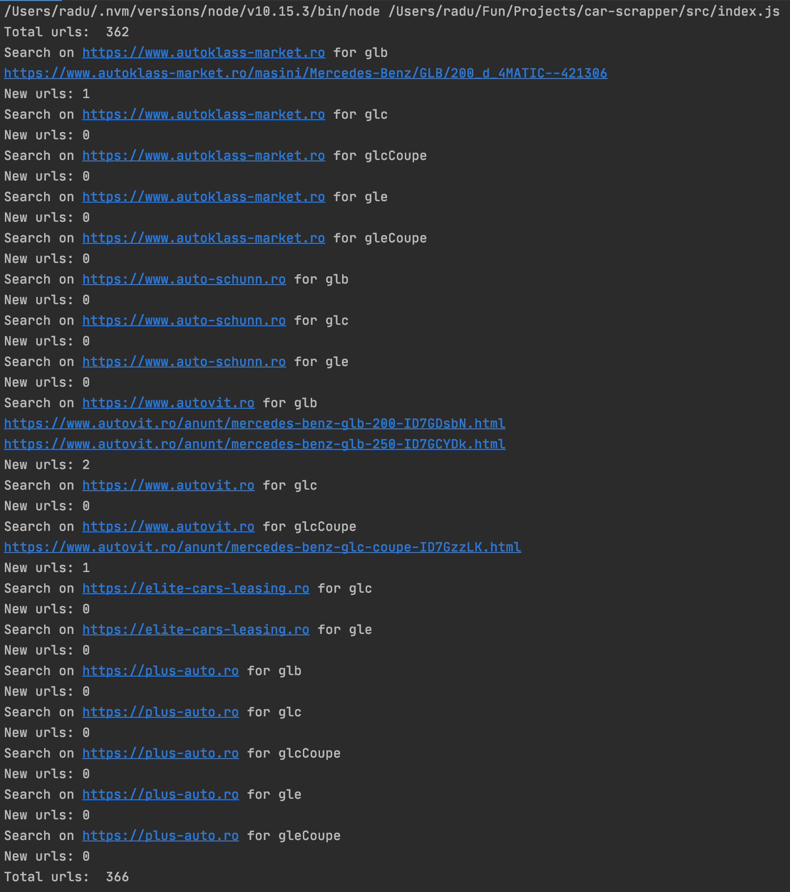

# car-scrapper

Scrap websites (autoklass, autoschunn, mobile.de) to search for specific cars 
and store the results in a local json file.

## Install

```
npm install
```

## Run

```
node index.js
```


